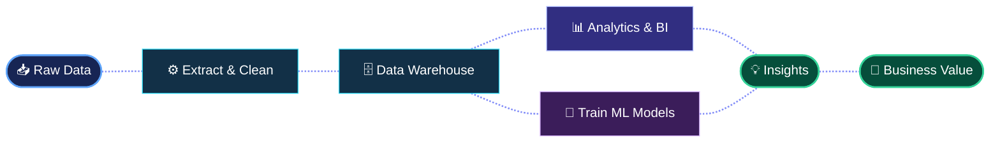

<div align="center">


<br/>

<a href="https://hager-abdelnasser.github.io/Hager_Abdelnasser-Portfolio/">

</a>

<a href="https://linkedin.com/in/hager-abdelnasser-b05a95356">

</a>

</div>

---

# 👋 Hello, I'm Hager!

## 👩‍💻 About Me

💻 Passionate about **Data Engineering & Data Analytics**

🎓 Faculty of Computers & Information — Ain Shams University

⚙️ **Data Engineering Track — Digital Egypt Pioneers Initiative (DEPI)**

🏢 **Data & AI Solutions Intern — HVIA**

🤖 Successfully completed **Machine Learning training by Huawei**, in collaboration with Egypt's Ministry of Youth and Sports.

🌍 **GCI World Program 2026** — International data-focused learning experience.

### 📚 Focused On

* 🔹 Data Engineering: ETL, Data Pipelines, SQL & Data Warehousing
* 🔹 Data Analytics: EDA, Power BI, DAX & Business Intelligence
* 🔹 Machine Learning: Data Preparation, Model Training & Evaluation
* 🔹 Python, Pandas, NumPy & SQL Server

---

# 🔄 The Journey of Data

<div align="center">



**ENGINEER → ANALYZE → PREDICT → CREATE VALUE**

</div>

---

# 🛠 Skills & Tools

### 💻 Programming & Databases

<div align="center">

</div>


### ⚙️ Data Engineering


### 📊 Data Analytics


### 🤖 Machine Learning


---

# 🔥 GitHub Streak

<div align="center">


</div>

---

### 📊 GitHub Stats & Activity
<p align="center">
  <a href="https://github.com/Hager-Abdelnasser">
    
  </a>
</p>
---

# 📊 GitHub Metrics Dashboard

<div align="center">


<br/>


</div>

---

### 🐍 GitHub Contribution Snake

<picture>
  <source media="(prefers-color-scheme: dark)" srcset="https://raw.githubusercontent.com/Hager-Abdelnasser/Hager-Abdelnasser/output/github-snake-dark.svg">
  <source media="(prefers-color-scheme: light)" srcset="https://raw.githubusercontent.com/Hager-Abdelnasser/Hager-Abdelnasser/output/github-snake.svg">
  
</picture>

---

# ⭐ Featured Projects

### ⭐ Olist End-to-End Data Pipeline & Analytics

End-to-end e-commerce ETL pipeline and analytics solution using Python, SQL Server, Star Schema, and Power BI.

🔗 [Explore Repository](https://github.com/Hager-Abdelnasser/Olist-End-to-End-Data-Pipeline-And-Analytics)

### 🏛 SQL Server Data Warehouse ETL

Data warehouse design and ETL workflows using SQL Server.

🔗 [Explore Repository](https://github.com/Hager-Abdelnasser/SQL-Server-Data-Warehouse-ETL)

### 🔄 Python-SQL E-Commerce ETL

A Python-based ETL pipeline for processing e-commerce data and loading it into SQL.

🔗 [Explore Repository](https://github.com/Hager-Abdelnasser/Python-SQL-Ecommerce-ETL)

### 📊 AdventureWorks Sales Analytics Dashboard

Interactive Power BI dashboard for sales performance and business KPIs.

🔗 [Explore Repository](https://github.com/Hager-Abdelnasser/AdventureWorks-Sales-Analytics-Dashboard-PowerBI)

### 🍕 Pizza Sales Analytics

Sales trends, KPIs, and performance insights using Power BI.

🔗 [Explore Repository](https://github.com/Hager-Abdelnasser/Pizza-Sales-Analytics-PowerBI)

### 🛒 E-Commerce Tableau Dashboard

E-commerce performance analysis and interactive visualizations.

🔗 [Explore Repository](https://github.com/Hager-Abdelnasser/E-Commerce-Tableau-Dashboard)

---

# 📬 Contact Me

<div align="center">

<a href="https://linkedin.com/in/hager-abdelnasser-b05a95356">

</a>

<a href="mailto:hagerabdelnasser933@gmail.com">

</a>

<br/><br/>

```python
class HagerAbdelnasser:
    focus = ["Data Engineering", "Data Analytics", "Machine Learning"]
    passion = "Turning Data into Decisions"

    def say_hi(self):
        print("Thanks for visiting my profile 🚀")
```
<blockquote align="center">
  💡 <b><i>"Without data, you're just another person with an opinion."</i></b><br>
  <i>«بدون بيانات، أنت مجرد شخص آخر يمتلك رأياً.»</i>
</blockquote>

</div>

<div align="center">

</div>
